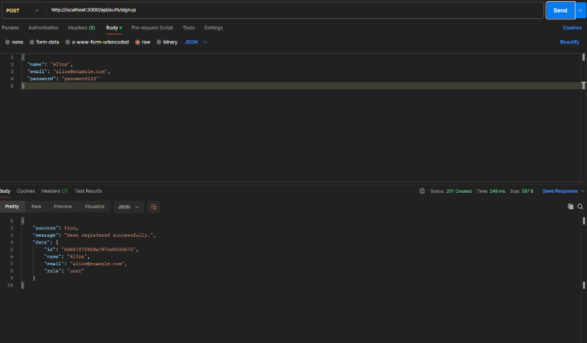
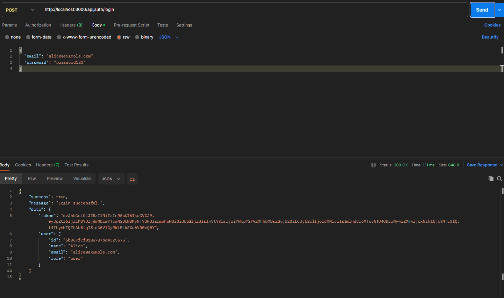
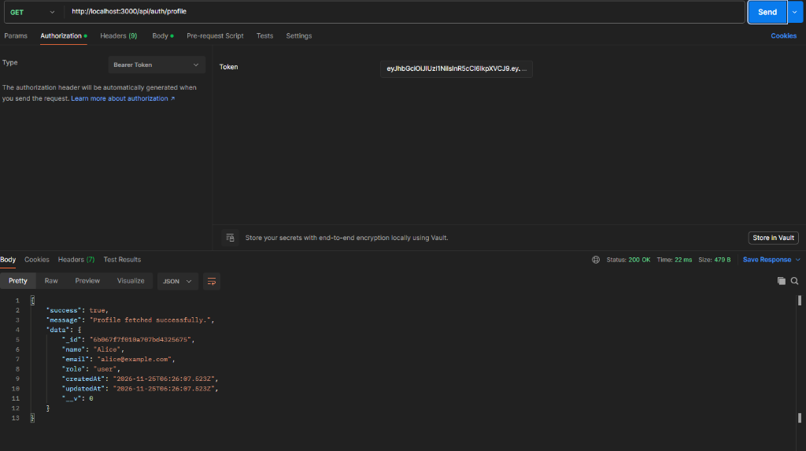
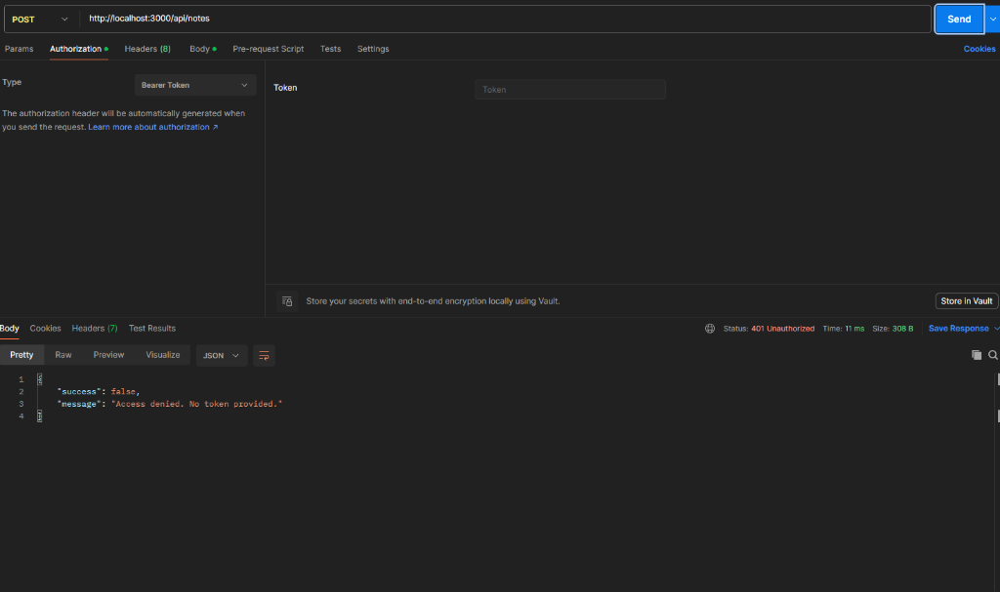
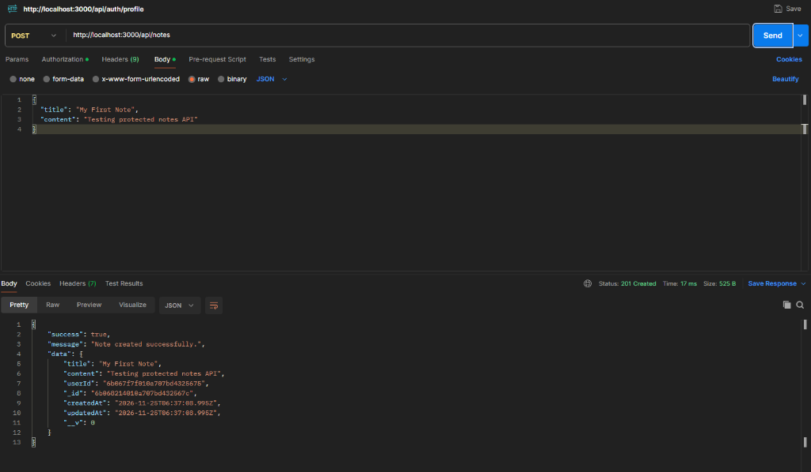
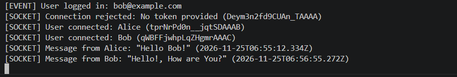

# Secure Connect & Communication Platform

**Web Development III – Lab 4**

A secure backend-only Node.js and Express application with JWT authentication, Role-Based Access Control (RBAC), personal Notes CRUD API, EventEmitter logging, MongoDB persistence, and authenticated real-time chat using Socket.IO. All testing is performed using **Postman**, **Postman Socket.IO requests**, and the **VS Code terminal**.

---

## Technologies Used

- **Node.js** – JavaScript runtime
- **Express.js** – Web framework for REST APIs
- **MongoDB & Mongoose** – NoSQL database and ODM
- **jsonwebtoken (JWT)** – Stateless token-based authentication
- **bcryptjs** – Password hashing with salt rounds
- **Socket.IO** – Real-time bidirectional communication
- **Node.js `events` (EventEmitter)** – Event-driven logging
- **dotenv** – Environment variable management

---

## API Endpoints

| Method | Endpoint | Description | Access |
|---|---|---|---|
| `GET` | `/` | Health check | Public |
| `POST` | `/api/auth/signup` | Register a new user | Public |
| `POST` | `/api/auth/login` | Login and receive JWT | Public |
| `GET` | `/api/auth/profile` | Get logged-in user's profile | Protected (JWT) |
| `GET` | `/api/admin/dashboard` | Admin-only dashboard | Protected (Admin role) |
| `POST` | `/api/notes` | Create a personal note | Protected (JWT) |
| `GET` | `/api/notes` | Get all notes of logged-in user | Protected (JWT) |
| `GET` | `/api/notes/:id` | Get a specific note by ID | Protected (JWT + Owner) |
| `PUT` | `/api/notes/:id` | Update a specific note | Protected (JWT + Owner) |
| `DELETE` | `/api/notes/:id` | Delete a specific note | Protected (JWT + Owner) |

---

## Sample API Requests & Responses

### 1. Signup (`POST /api/auth/signup`)
Request:
```json
{
  "name": "Alice",
  "email": "alice@example.com",
  "password": "password123"
}
```
Response (`201 Created`):
```json
{
  "success": true,
  "message": "User registered successfully.",
  "data": {
    "id": "65f1...",
    "name": "Alice",
    "email": "alice@example.com",
    "role": "user"
  }
}
```

### 2. Login (`POST /api/auth/login`)
Request:
```json
{
  "email": "alice@example.com",
  "password": "password123"
}
```
Response (`200 OK`):
```json
{
  "success": true,
  "message": "Login successful.",
  "data": {
    "token": "eyJhbGciOiJIUzI1NiIs...",
    "user": {
      "id": "65f1...",
      "name": "Alice",
      "email": "alice@example.com",
      "role": "user"
    }
  }
}
```

### 3. Create Note (`POST /api/notes`)
Header: `Authorization: Bearer <token>`
Request:
```json
{
  "title": "Lab 4 Notes",
  "content": "Review JWT and Socket.IO authentication."
}
```
Response (`201 Created`):
```json
{
  "success": true,
  "message": "Note created successfully.",
  "data": {
    "_id": "65f2...",
    "title": "Lab 4 Notes",
    "content": "Review JWT and Socket.IO authentication.",
    "userId": "65f1...",
    "createdAt": "...",
    "updatedAt": "..."
  }
}
```

---

## Socket.IO Events

Socket connections require a valid JWT passed via `Authorization: Bearer <token>` header or `auth.token`. Unauthenticated connections are rejected.

### Client to Server
- `join_chat` – Joins the authenticated user to the common chat room (`secure_connect_room`).
- `send_message` – Sends `{ "message": "..." }` to the server; the server attaches `senderName` from the verified JWT and broadcasts it.

### Server to Client
- `user_joined` – Broadcasts `{ userName, message, timestamp }` when a user joins the room.
- `receive_message` – Broadcasts `{ senderId, senderName, message, timestamp }` to all users in the room.
- `user_left` – Broadcasts `{ userName, message, timestamp }` when a connected user disconnects.

---

# Practical Output Screenshots

### Fig 1. Signup and Login Responses








*Fig 1. Signup and login responses showing successful registration, password hashing, JWT generation, and server-side event logs.*

---

### Fig 2. Protected Notes API






*Fig 2. Notes API demonstrating protected route access: unauthorized requests are blocked while authenticated requests are allowed.*

---

### Fig 3. Real-Time Chat Using Socket.IO




*Fig 3. Real-time communication between authenticated users using Socket.IO, with server-side connection and message logs.*

